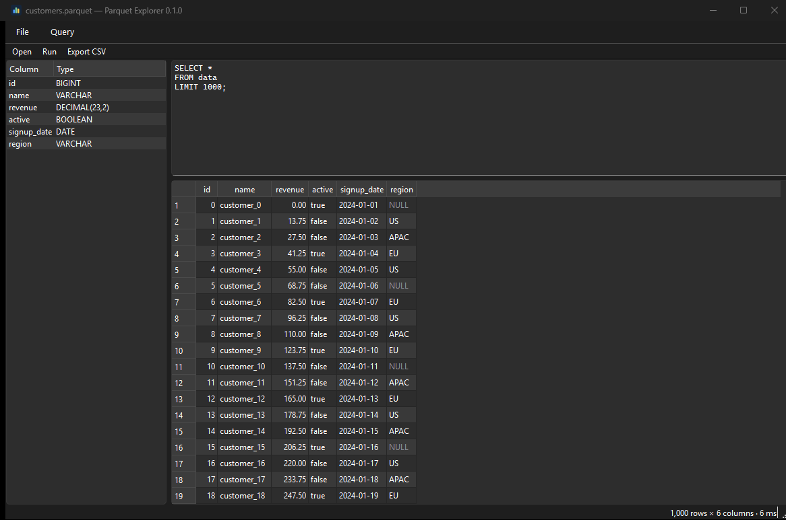

<div align="center">


# Parquet Explorer

**Open a Parquet file, run SQL against it, read the results in a grid.**

A small desktop app built on [Qt](https://doc.qt.io/qtforpython/) and
[DuckDB](https://duckdb.org).

[](https://github.com/angel-milanov/parquet-explorer/actions/workflows/ci.yml)
[](https://angel-milanov.github.io/parquet-explorer/)
[](LICENSE)
[](pyproject.toml)

[**Documentation**](https://angel-milanov.github.io/parquet-explorer/) ·
[Install](https://angel-milanov.github.io/parquet-explorer/installation/) ·
[Usage](https://angel-milanov.github.io/parquet-explorer/usage/) ·
[Changelog](CHANGELOG.md)



</div>

## What it does

- **Open a Parquet file** — from the file dialog, by dragging it onto the window,
  or as a command-line argument.
- **Query it with SQL.** The file is registered as a view named `data`, and the
  editor starts on `SELECT * FROM data LIMIT 1000` — press <kbd>Ctrl</kbd> +
  <kbd>Enter</kbd> to run. Anything DuckDB understands works: joins against other
  files, aggregates, window functions, `SUMMARIZE data`.
- **Read the results** in a grid with numbers right-aligned, `NULL`s rendered
  distinctly rather than as blanks, and the shape and timing of the query in the
  status bar.
- **Browse the schema** in the side panel; double-click a column to insert its name
  into the editor.
- **Read the schema as Avro** — <kbd>Ctrl</kbd> + <kbd>Shift</kbd> + <kbd>A</kbd>
  shows the file's structure as an Avro record (`.avsc`) and copies it to the
  clipboard, nested lists, maps and structs included.
- **Export** the current query's result to CSV.
- **Help → About** for the version of the app and the libraries under it, plus the
  full license text of everything shipped.

Query errors appear inline above the grid with DuckDB's message, and the previous
result stays on screen so a typo doesn't lose your place.

## Install

Standalone builds for Windows, macOS and Linux are attached to every
[release](https://github.com/angel-milanov/parquet-explorer/releases) — no Python
needed. Windows has a `setup.exe`, macOS a `.dmg`, Linux a `tar.gz`.

From PyPI:

```bash
uv tool install parquet-explorer   # or: pipx install parquet-explorer
```

Or run it straight out of a clone:

```bash
git clone https://github.com/angel-milanov/parquet-explorer
cd parquet-explorer
uv run parquet-explorer path/to/file.parquet
```

Full instructions, including the Gatekeeper and Qt system-library notes, are in the
[installation guide](https://angel-milanov.github.io/parquet-explorer/installation/).

## Usage

```
parquet-explorer [file]

  file          Parquet file to open on startup
  --version     Print the version and exit
```

| Shortcut | Action |
| --- | --- |
| <kbd>Ctrl</kbd> + <kbd>O</kbd> | Open a Parquet file |
| <kbd>Ctrl</kbd> + <kbd>Enter</kbd> or <kbd>F5</kbd> | Run the query |
| <kbd>Ctrl</kbd> + <kbd>E</kbd> | Export the result to CSV |
| <kbd>Ctrl</kbd> + <kbd>Shift</kbd> + <kbd>A</kbd> | Show the schema as Avro (`.avsc`) |
| <kbd>Ctrl</kbd> + <kbd>Shift</kbd> + <kbd>C</kbd> | Copy the Avro schema to the clipboard |

Results are fetched in full, so a query returning tens of millions of rows will use
a matching amount of memory — keep a `LIMIT` on exploratory queries, or aggregate in
SQL. See [using the app](https://angel-milanov.github.io/parquet-explorer/usage/)
for the queries worth knowing.

## Development

```bash
uv sync                   # install runtime, dev and packaging dependencies
uv run parquet-explorer   # launch
uv run pytest             # test
uv run ruff check .       # lint
uv run ruff format .      # format
uv run mypy               # type-check
```

The GUI tests run headless via `QT_QPA_PLATFORM=offscreen`, which CI sets for you.

The code is a handful of modules:

| Module | Responsibility |
| --- | --- |
| `parquet_explorer/data.py` | DuckDB connection, opening files, running SQL, CSV export. No Qt. |
| `parquet_explorer/parquet_schema.py` | Decodes the Parquet footer to a schema tree. No Qt, no DuckDB. |
| `parquet_explorer/avro.py` | Translates that tree into an Avro record schema. |
| `parquet_explorer/models.py` | `QAbstractTableModel` that renders a result in the grid. |
| `parquet_explorer/window.py` | The window: toolbar, schema panel, editor, grid, status bar. |
| `parquet_explorer/about.py` | The About dialog, over `licenses.py` and `license_texts.py`. |

Multi-step packaging commands are named in `[tool.poe.tasks]`; `uv run poe` lists
them. `bundle` builds the standalone app, `installer` builds the Windows installer,
`dmg` builds the macOS disk image, `docs` serves this documentation locally.

Contributions are welcome — see [CONTRIBUTING.md](CONTRIBUTING.md), and
[packaging](https://angel-milanov.github.io/parquet-explorer/packaging/) for how
releases are built.

## License

[MIT](LICENSE).

Parquet Explorer links against Qt through PySide6, which is licensed under the
LGPL v3. The standalone bundles therefore redistribute LGPL Qt libraries alongside
the MIT-licensed application code. Every license the app ships under is reproduced
in full under **Help → About Parquet Explorer → Licenses**.
