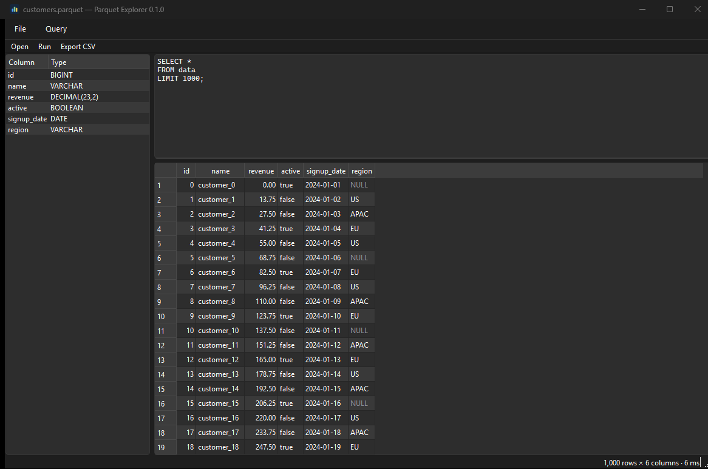

# Parquet Explorer

A desktop app for looking inside Parquet files. Open a file, write SQL against it
with [DuckDB](https://duckdb.org), and read the results in a data grid.

{ .screenshot }

## What it does

<div class="grid cards" markdown>

- :material-file-document-outline: **Open a Parquet file**

    Through the file dialog, by dragging it onto the window, or as a command-line
    argument.

- :material-database-search: **Query it with SQL**

    The file is registered as a view named `data`, and the editor starts on
    `SELECT * FROM data LIMIT 1000`. Anything DuckDB understands works.

- :material-table: **Read the results**

    Numbers right-aligned, `NULL`s rendered distinctly rather than as blanks, and
    the shape and timing of the query in the status bar.

- :material-file-export-outline: **Export**

    Write whatever the current query returns to a CSV file.

</div>

## Get started

<div class="grid cards" markdown>

- :material-download: **[Install](installation.md)** — standalone builds for
  Windows, macOS and Linux, or install from PyPI with `uv` or `pipx`.
- :material-book-open-variant: **[Using the app](usage.md)** — the query editor,
  keyboard shortcuts, and SQL worth knowing.
- :material-hammer-wrench: **[Contributing](contributing.md)** — how to set up a
  development environment and what the project looks for in a pull request.
- :material-package-variant-closed: **[Packaging](packaging.md)** — how the
  standalone bundles, the Windows installer and releases are built.

</div>

## A quick taste

Open a file and the editor is already pointed at it:

```sql
SELECT * FROM data LIMIT 1000;
```

Press ++ctrl+enter++ after editing to re-run. Because it is real DuckDB, the
interesting queries are the ones you already know:

```sql
-- What is in this file, column by column?
SUMMARIZE data;

-- Group and aggregate
SELECT region, count(*) AS customers, round(avg(revenue), 2) AS avg_revenue
FROM data
GROUP BY region
ORDER BY customers DESC;
```

!!! note "Results are held in memory"

    A query's rows are fetched in full rather than paged, so a result with tens of
    millions of rows will use a matching amount of memory. Keep a `LIMIT` on
    exploratory queries, or aggregate in SQL.

## License

[MIT](https://github.com/angel-milanov/parquet-explorer/blob/main/LICENSE).
Parquet Explorer links against Qt through
[PySide6](https://doc.qt.io/qtforpython/), which is licensed under the LGPL v3, so
the standalone bundles redistribute LGPL Qt libraries alongside the MIT-licensed
application code.
